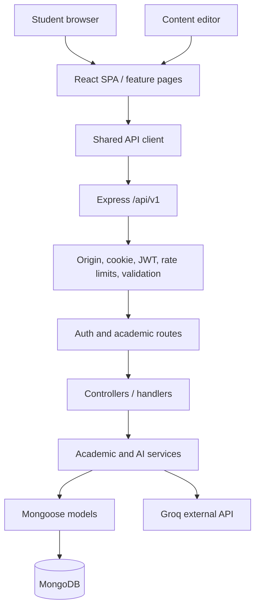

# APEX — Current-State Engineering Architecture and Standardization Playbook

**Baseline:** 12 November 2026 · **Scope:** uploaded `apex_work (3).zip` and the accompanying frontend modularization · **Status:** implementation documented; deployment and browser verification not claimed.

> **Reading rule:** “Observed” means the supplied source code contains the behavior; “Standard” means a rule adopted by this playbook; “Gap” means not demonstrated or not yet implemented. This is a current-state baseline, not a future product roadmap.

## 1. Executive summary

APEX is an OAU JUPEB academic learning workspace for Mathematics, Physics and Chemistry. It combines student accounts, academic profiles, structured syllabus content, topic coverage, study plans, daily five-question assessments, progress statistics and Groq-backed AI academic analysis. A content-editor interface maintains syllabuses and question banks. The product hypothesis is that learners benefit from a single workspace joining *what to study*, *what they have studied*, *what they understand*, and *what to study next*. This is a product hypothesis, not measured evidence of improved academic outcomes.

The system is a React/Vite single-page application communicating over a versioned JSON HTTP API with an Express/Mongoose backend and MongoDB. Authentication uses JWT sessions in an HttpOnly cookie. The backend is organized into routes, controllers, middleware, validators, services, models and utilities. The supplied frontend previously concentrated roughly 1,200 lines in `main.jsx` and 302 lines in `Admin.jsx`; the delivered refactor distributes feature pages, shared UI, layout, authentication context, data loading, and administration controller logic into named modules. **This is a structural refactor, not a redesign.**

### 1.1 What the project does not establish

There is no demonstrated production deployment, measured performance SLO, CI pipeline, end-to-end browser suite, complete integration-test coverage, external payment system, notification pipeline, institutional SIS integration, or evidence of validated learning outcomes. No such capability should be asserted to investors, educators, developers or users until verified.

## 2. Product and business model

**Audience:** students preparing for the OAU JUPEB programme; **secondary operators:** authorized academic content editors. **Core user jobs:** create an academic profile; browse verified syllabus topics; record lecture coverage and understanding; plan work; answer daily questions; inspect performance; request AI analysis. **Operational jobs:** maintain accurate programme-topic mappings, question options and answer keys. **Success metrics to define before launch:** profile completion, first plan created, daily active learners, weekly study activity completion, assessment completion, question-bank coverage by subject, content correction turnaround, AI analysis success, retention, and reported learning usefulness. None of these metrics is currently demonstrated as tracked analytically.

### 2.1 Domain language

- **User:** authenticated account and owner of personal learning records.
- **Academic profile:** student programme, subjects, available hours and weaknesses.
- **Syllabus:** programme + subject content container with embedded topics and subtopics.
- **Topic progress:** learner-specific topic coverage and self-reported understanding.
- **Study plan:** learner-owned plan containing dated activities.
- **Question:** assessment item mapped to a topic, with answer/explanation protected from normal student question reads.
- **Assessment:** one assigned daily question set and its eventual submission.
- **AI analysis:** model-generated advisory feedback from structured academic data, not a deterministic grading source.

## 3. Architecture at a glance



**Trust boundaries:** browser ↔ API, unauthenticated ↔ authenticated, student ↔ editor, API ↔ database, API ↔ AI provider. The React navigation hides editor links for unauthorized accounts, but server-side `editor` middleware is the actual authorization boundary. **Standard:** never treat conditional frontend rendering as authorization.

## 4. System request lifecycle

1. Browser renders `main.jsx` → `App` and calls `/auth/me` to restore a cookie-backed session.
2. `App` stores the authenticated user in `AuthContext`, or navigates to login/register.
3. `Shell` renders sidebar navigation and a nested feature route.
4. Feature pages call the shared `api()` helper, which prefixes `/api/v1`, sends JSON and includes cookies.
5. Express assigns request IDs, sets security headers, parses cookies, checks origin on cookie-authenticated writes, applies CORS, parses JSON and enforces rate limits.
6. Routes require authentication, apply editor authorization where appropriate, validate request bodies and dispatch to controllers/services.
7. Services enforce domain rules and user ownership, query Mongoose models, and return data.
8. Controllers normalize successful/error responses; the frontend renders loading, success or error states.

**Standard:** keep UI presentation, client transport, HTTP authorization, request validation, domain rules and persistence distinct. Do not duplicate server-owned business invariants solely in frontend code.

## 5. Frontend architecture after modularization

| Layer | Location | Responsibility | Dependency direction |
|---|---|---|---|
| Bootstrap | `client/src/main.jsx` | Mount React and global CSS | Imports `App` only |
| Composition | `client/src/App.jsx` | Session restore, top-level auth routing | Context, API, auth page, shell |
| Context | `client/src/context/AuthContext.jsx` | Expose authenticated user and actions | React only |
| Layout | `client/src/layouts/Shell.jsx` | Sidebar, header, nested routes | Feature pages and auth context |
| Features | `client/src/features/*` | Screens and feature-specific UI | Shared hooks/UI/API |
| Shared UI | `client/src/components/ui/*` | Notice, Header, Metric | No domain persistence |
| Shared hook | `client/src/hooks/useLoad.js` | Loading, errors, manual refresh | API client |
| Utilities | `client/src/lib/format.js` | Subject list, date formatting, class joining | Pure functions |
| Transport | `client/src/api.js` | JSON fetch, credentials, typed API errors | Browser fetch |
| Admin controller | `client/src/features/admin/useAdminController.js` | Editor state, CRUD handlers, filtering | API, admin form defaults |
| Admin page | `client/src/features/admin/Admin.jsx` | Editor rendering | Admin controller, UI primitives |

### 5.1 Refactor invariants

The same feature URLs (`/`, `/profile`, `/syllabus`, `/plans`, `/assessment`, `/progress`, `/analysis`, `/admin`) and `/api/v1` transport contract remain. The same JSX bodies and event handlers are retained except for imports/exports and relocation of admin controller logic. No server endpoint, database schema or product behavior was intentionally changed. This lowers migration risk but **does not prove behavioral equivalence** without a successful build and browser regression run.

### 5.2 Feature ownership

- `features/auth/Login.jsx`: registration/login form, session initiation.
- `features/dashboard/Dashboard.jsx`: overview, current activities and assessment availability.
- `features/profile/Profile.jsx`: academic profile editing.
- `features/syllabus/Syllabus.jsx`: content browsing and topic-progress interaction.
- `features/plans/Plans.jsx`: plan creation, generation and activity management.
- `features/assessment/Assessment.jsx` and `ActivityLog.jsx`: daily questions and activity logging.
- `features/progress/Progress.jsx`: aggregate learning metrics.
- `features/analysis/Analysis.jsx`: AI academic analysis presentation.
- `features/admin/AdminNav.jsx`: authorized navigation visibility.
- `features/admin/Admin.jsx`: syllabus and question management interface.

### 5.3 Frontend dependency rules — standards

1. Feature screens may import shared UI, shared hooks, domain-neutral helpers and the API client; they should not import sibling feature internals except an explicitly shared component.
2. Context must not import pages; this avoids cyclic dependencies.
3. UI components should receive values/callbacks rather than call persistence directly unless explicitly documented as feature containers.
4. Hooks own reusable stateful behavior, not markup; utility modules own pure transformations.
5. `api.js` is the only standard location for browser HTTP transport details.
6. Keep feature-specific state local; move state to context only when multiple distant screens genuinely share it.
7. Route authorization must remain server-enforced.
8. Avoid creating a separate file for every trivial expression; module boundaries should correspond to meaningful responsibility.

## 6. Administration module

**Observed:** `AdminNav` performs an access probe; the admin page independently verifies editor access and loads syllabus and question data. The page supports syllabus/topic/subtopic editing and question creation, editing and deletion. Editor forms handle saving/loading/error/success feedback. The initial question list is capped at 100, so search is **client-side over the loaded subset**, not a full-database search. Destructive operations ask for browser confirmation and warn about references from learning records.

**Refactor:** UI primitives (`Field`, `Input`, `Textarea`, `Select`, `Button`, `Alert`, `Stat`) are in `adminUI.jsx`; data fetching, mutation handlers and form state are in `useAdminController.js`; access-based navigation is in `AdminNav.jsx`; the page renders the returned state. This is an initial container/view split; the admin page still contains several editor/list sections that could later be extracted independently if behavior tests justify it.

**Risk:** deleting topics or questions can invalidate historical references. **Standard:** use content lifecycle states, archival/deprecation, or explicit referential-integrity checks before permitting production deletion. **Gap:** no proof of such a policy in the current code.

## 7. Backend layers and responsibilities

| Layer | Directory | Contract |
|---|---|---|
| Entry point | `src/server.js` | Load config, connect database, listen |
| HTTP composition | `src/app.js` | Middleware ordering, security, route mounting |
| Routing | `src/routes/` | URLs, methods, middleware, handler dispatch |
| Controllers | `src/controllers/` | Request/response adaptation |
| Middleware | `src/middleware/` | Auth, editor access, request ID, limits, validation, error handling |
| Services | `src/services/` | Academic operations and AI integration |
| Models | `src/models/` | Persistence schemas and indexes |
| Validators | `src/validators/` | Zod input contracts |
| Utilities | `src/utils/` | Dates, pagination, error types, ID validation |

**Observed:** academic routes are thin; most domain logic is in `academicService.js`. **Tradeoff:** centralization makes cross-feature flows discoverable but is a growing single-file responsibility concentration. **Standard:** split by cohesive domain service only after adding regression tests; avoid speculative abstractions.

## 8. Authentication and session management

`/auth/register` and `/auth/login` validate request bodies. `/auth/me` checks the active authenticated session; `/auth/logout` clears it. Authentication middleware protects all academic routes. JWT is stored in an HttpOnly cookie, reducing direct JavaScript access to the session token. HttpOnly does not eliminate CSRF, XSS or account takeover risks. The server checks allowed browser origins for state-changing cookie-authenticated requests; CORS uses explicitly configured origins. **Standard:** configure HTTPS, cookie attributes, JWT rotation/expiry, account recovery, audit logging, brute-force protections and secret management before launch; verify each from code and deployed settings.

## 9. Authorization model

The editor permission is tied to `CONTENT_EDITOR_EMAILS` and checked by `contentEditorMiddleware.js`. Write routes for syllabuses/questions use this middleware. Student progress, plans and assessments use the authenticated user ID and service ownership checks. **Important:** role-like editor permission is an environment-managed allowlist, not a full RBAC administration system. **Standard:** treat it as a temporary operating policy with documented access grants and revocations; do not call it comprehensive RBAC.

## 10. Input validation and error handling

Zod schemas validate HTTP payloads; Mongoose adds persistence-level constraints. ObjectId validation is applied before ID-based lookups. `AppError`, `asyncHandler`, request ID middleware and centralized error middleware separate expected domain failures from unexpected server failures. **Standard:** keep errors actionable but never reveal secrets, password hashes, model answer keys, internal stack traces or raw provider credentials. Correlate user-visible request IDs with server logs.

## 11. Academic profile lifecycle

Profile data drives syllabus selection, plan generation and assessment eligibility. A student creates/updates the profile via `/academic/profile`. Service `saveProfile` performs an upsert with validators. **Invariants:** a profile belongs to the authenticated user; subject names must align with syllabus content; weekly study hours affect plan scheduling; declared weaknesses influence prioritization. **Gap:** self-reported weaknesses and understanding have no demonstrated psychometric validation.

## 12. Syllabus and content taxonomy

Syllabus documents contain programme/subject metadata and embedded topic/subtopic structures. Student progress and questions reference topic IDs. This offers a compact read model but makes edits and deletions to embedded topic IDs sensitive. **Standard:** preserve topic identifiers when editing; use reviewed content provenance and versioning; document how changed curricula affect existing student records. Content accuracy is a domain governance problem, not just a database problem.

## 13. Progress tracking

`TopicProgress` stores user-specific coverage and understanding. `setProgress` resolves the syllabus topic before updating progress, preventing arbitrary unrelated topic IDs. Aggregate statistics count covered relevant topics and report understanding. **Standard:** distinguish lecture coverage, actual practice and demonstrated mastery; current self-report is not an objective exam readiness score.

## 14. Study planning and scheduling

Manual plan CRUD and activity CRUD are available. Generated plans use profile subjects, syllabus topics, progress and weaknesses. The generator ranks weak or low-understanding topics, computes a daily budget from weekly hours and creates dated activities. **Observed design:** rule-based scheduling, not AI-generated planning. **Tradeoffs:** understandable, reproducible, inexpensive; but heuristic prioritization does not guarantee optimal scheduling, spaced repetition or pedagogical efficacy. **Standard:** document algorithm inputs, ordering, calendar semantics, rounding and behavior when topic demand exceeds available hours.

## 15. Daily assessments

The daily endpoint creates or returns one assessment for the current application-local day. It chooses five questions from the eligible pool, prioritizing weaknesses and lower understanding. At least five eligible questions are required. Duplicate creation is handled through database uniqueness and a retry read. Submissions must contain exactly the assigned five unique questions; a submitted assessment cannot be submitted again. Answer keys and explanations are selected privately for grading, and normal question reads omit answer keys. **Risk:** question selection is deterministic priority-based and can overexpose the same top-ranked content; investigate coverage, fairness, freshness and question versioning before launch.

## 16. Statistics and dashboard

Statistics aggregate relevant syllabus coverage, plan activity completion, actual study minutes, recent scores and topic mastery. The dashboard returns the most recent plan, today's activities, assessment availability and statistics. **Standard:** document every metric denominator and eligibility filter; distinguish activity logs from measured study time and test scores from learning outcomes.

## 17. AI integration

`aiService.js` integrates Groq and validates a structured analysis shape with Zod. Academic analysis is advisory and should never be presented as verified academic judgment. **Standard:** use minimal required user data, avoid logging sensitive prompts/responses, enforce rate limits, timeouts and provider error handling, version prompts, and evaluate outputs against a fixed set of cases. **Gap:** there is no demonstrated formal AI evaluation harness or human-reviewed safety rubric.

## 18. Dates and time zones

`APP_TIME_ZONE` defaults to `Africa/Lagos`. Day keys are generated in the configured application timezone; date utilities handle calendar-day arithmetic. Study-plan dates are represented at UTC noon to reduce timezone shifts. **Standard:** separate instant timestamps from calendar-only dates; test midnight boundaries, DST for non-Lagos configurations and serialization in different browser time zones.

## 19. Pagination and query efficiency

The backend has shared pagination helpers and paginated plan/question/result reads. The admin UI requests only the first 100 questions. **Standard:** define max page size, deterministic sort, index coverage and API pagination metadata; avoid loading unbounded documents into memory. **Gap:** no query-plan benchmarks or realistic data-volume load tests supplied.

## 20. Engineering principles: observed versus aspirational

| Principle | Assessment | Evidence / qualification |
|---|---|---|
| Separation of concerns | Partially implemented | Backend layers and refactored frontend; broad academic service remains |
| DRY | Partially implemented | Shared API client, validation, date/pagination utilities, shared UI; some repeated page patterns remain |
| SOLID / SRP | Partial | Routes/controllers narrower; academic service and some pages remain multi-responsibility |
| Dependency inversion | Limited | Direct imports of services/models; no explicit interface ports/adapters |
| KISS | Strong design tendency | Straightforward CRUD, rule-based study-plan algorithm |
| YAGNI | Generally consistent | No unnecessary distributed microservices or speculative event infrastructure |
| Modularity | Improved by refactor | Feature folders, context, hook, layout, admin controller |
| Encapsulation | Partial | State in feature modules; service boundaries still broad |
| Defense in depth | Partial | JWT, origin checks, validation, rate limits, Mongoose; needs deployment testing |
| Least privilege | Partial | Editor allowlist, ownership checks; not a complete roles/permissions system |
| Fail-safe defaults | Partial | Protected academic routes; external service failure and config review needed |
| Idempotency | Case-specific | Profile upsert and daily assessment uniqueness; other writes not uniformly idempotent |
| Determinism | Mostly for planning | Heuristic planner; provider AI is not deterministic by contract |
| Observability | Basic | Request IDs and errors; no demonstrated tracing/metrics platform |
| Testability | Limited | Some Node unit tests; no frontend or DB integration suite supplied |
| Performance engineering | Not validated | Pagination and bounded lists exist; no SLO/load evidence |
| Accessibility | Not audited | Some labels/ARIA; no automated/manual WCAG audit |
| Maintainability | Improved, not certified | Smaller frontend modules; documentation and tests still needed |

## 21. Design decisions and tradeoff register

| Decision | Why it makes sense now | Cost / trigger to reconsider |
|---|---|---|
| Monolithic API deployment | Simple operations for early-stage product | Split only for proven scaling/ownership constraints |
| MongoDB + Mongoose | Flexible document modeling for syllabus and activities | Referential integrity and embedded topic mutation risk |
| React SPA | Fast client-side navigation | Browser-only auth loading, SEO limitations for public content |
| HttpOnly JWT cookie | Browser cannot directly read token | CSRF/origin/cookie deployment complexity |
| Environment editor allowlist | Small operator group, minimal setup | Difficult auditing and delegation as team grows |
| Groq external inference | Avoid self-hosted models | Cost, privacy, outages, prompt evaluation |
| Rule-based planner | Explainable and cheap | Limited personalization sophistication |
| Five daily questions | Predictable, small daily workload | Limited statistical precision; content coverage |
| Feature-based frontend folders | Clear page ownership | Shared code drift if abstraction boundaries are ignored |
| Shared API wrapper | Consistent errors and credentials | Must handle evolving API contracts centrally |

## 22. Security threat-model starter

| Threat | Existing control | Verification needed |
|---|---|---|
| Credential guessing | Auth-specific rate limit | Thresholds, proxy IP behavior, abuse tests |
| Unauthorized content edits | Server editor middleware | Test all editor endpoints and revocation |
| Cross-user data access | Service ownership filters | Negative integration tests for every ID route |
| CSRF on cookie session | Origin check on writes | Browser, same-site and deployment topology testing |
| Malicious JSON input | Zod + Mongoose | Size/shape limits and error-path tests |
| Answer-key disclosure | Question response projection | API response snapshots and historical results |
| Secrets leakage | `.gitignore` and env configuration | Repository history/CI/log review, rotate leaked keys |
| External AI prompt injection | Structured schema validation | Prompt-content adversarial testing |
| Dependency vulnerability | Lockfiles | Dependency audit and remediation process |

## 23. Reliability and operations standards

**Startup:** fail clearly if required database/auth configuration is missing. **Readiness:** distinguish a process being alive from its database and external dependencies being ready. **Logs:** structured request ID, method, route, status, latency and sanitized errors. **Backups:** encrypted MongoDB backups and practiced restore. **Recovery:** document RPO/RTO targets before launch. **Deploy:** immutable builds, separate environment secrets, health checks and rollback path. **Incident response:** ownership, severity levels, escalation and post-incident action tracking. These are standards to adopt, not claims that the ZIP already implements them.

## 24. Testing strategy and release gates

**Existing tests:** `tests/date.test.js`, `tests/errorHandling.test.js`, `tests/pagination.test.js`. **Required next gates:** backend unit tests for planner/scoring; MongoDB-backed tests for ownership, editor access, assessment uniqueness and deletion; frontend rendering and form tests; browser E2E flows for register→profile→plan→assessment; API contract snapshots; accessibility audit; performance smoke tests; secret scan; dependency audit; backup restore drill. **Do not label a build production-ready based only on `npm test`.**

## 25. Source-of-truth and change control

The README explains product scope and setup; routes/validators/models/services are authoritative for implemented API behavior; feature modules are authoritative for current UI. Keep architecture diagrams and API tables synchronized with code changes. For each significant change, record context, options, decision, tradeoffs, rollback, tests and owner in an ADR. **Standard:** documentation updates and regression evidence are part of the definition of done.

## 26. Coding and review conventions

- Prefer clear names (`saveProfile`, `useAdminController`) over abstract abbreviations.
- One cohesive responsibility per module; do not force tiny files where that harms discoverability.
- Use immutable React state updates and avoid direct mutation of state objects.
- Keep backend authorization and domain invariants server-side.
- Validate inputs at boundaries; avoid redundant transformations that hide errors.
- Handle async loading/error/empty states explicitly.
- Never silently swallow security-critical failures.
- Do not leak secrets or correct answers through normal student endpoints.
- Add tests before splitting critical academic service functions.
- Preserve public route and JSON contracts unless versioned migration is planned.

## 27. Current limitations and risks, prioritized

**P0 before public launch:** confirm secrets are not exposed and rotate any previously shared; verify build; run end-to-end login/profile/plan/assessment/admin tests; verify production cookie/CORS/HTTPS; confirm content and answer keys; database backups; ownership/authorization negative tests.

**P1:** improve frontend test coverage, content lifecycle/versioning, question-bank pagination/search, telemetry, AI evaluations, accessibility, rate-limit/proxy configuration, data deletion/privacy policies, and error-state UX.

**P2:** split the broad academic service by bounded context, consider caching only after profiling, introduce a formal permission system if operator count grows, instrument learning metrics, evaluate planner and assessment selection quality.

## 28. Handover and future evolution protocol

This document freezes the **current implementation** and explicitly separates it from future requirements. When the product roadmap is supplied, start with a gap analysis against this baseline; draft ADRs for major changes; identify API/data migrations; assign measurable acceptance criteria; build regression tests; stage rollout and define rollback. Do not rewrite existing behavior merely to match a future architecture preference without a demonstrated need.

## 29. Developer onboarding walkthrough

1. Read this playbook and the root `README.md`.
2. Inspect `client/src/main.jsx` → `App.jsx` → `layouts/Shell.jsx` to understand routing.
3. Follow one feature page through `client/src/api.js` to `src/routes/academicRoutes.js`.
4. Trace middleware → controller → academic service → model and back.
5. Read the validation schema for the same operation.
6. Read `src/utils/date.js` before changing calendar behavior.
7. Inspect `src/services/aiService.js` before changing AI payloads.
8. Run backend tests, frontend build and the manual smoke checklist below.
9. Keep test evidence and documentation alongside the change.

## 30. Manual smoke-test checklist

- [ ] New user registers, logs in, refreshes session, logs out.
- [ ] Unauthorized browser cannot access academic endpoints.
- [ ] Non-editor cannot create/edit/delete syllabus or questions.
- [ ] Editor can add syllabus, topic, subtopic and question.
- [ ] Student can save profile, browse syllabus, update progress.
- [ ] Student can create and generate plans; edit/reschedule activities.
- [ ] Student can fetch and submit exactly one daily assessment.
- [ ] Correct answers are hidden until authorized result flow.
- [ ] Dashboard/statistics reflect submitted activity.
- [ ] AI analysis handles configured and unconfigured provider states.
- [ ] Loading, empty, error and mobile navigation states render.
- [ ] Dates behave correctly around midnight in application timezone.

## 31. Source inventory and ownership map

This inventory enumerates implementation files to help a developer navigate the actual repository. Line counts are approximate, and the descriptions are derived from filenames and source organization; inspect the file for full behavior.

| File | Lines | Primary role |
|---|---:|---|
| `client/postcss.config.js` | 7 | Frontend feature or shared UI |
| `client/src/App.jsx` | 59 | Frontend feature or shared UI |
| `client/src/api.js` | 46 | Frontend feature or shared UI |
| `client/src/components/ui/Header.jsx` | 15 | Frontend feature or shared UI |
| `client/src/components/ui/Metric.jsx` | 16 | Frontend feature or shared UI |
| `client/src/components/ui/Notice.jsx` | 26 | Frontend feature or shared UI |
| `client/src/context/AuthContext.jsx` | 3 | Frontend feature or shared UI |
| `client/src/features/admin/Admin.jsx` | 116 | Frontend feature or shared UI |
| `client/src/features/admin/AdminNav.jsx` | 19 | Frontend feature or shared UI |
| `client/src/features/admin/adminUI.jsx` | 46 | Frontend feature or shared UI |
| `client/src/features/admin/useAdminController.js` | 135 | Frontend feature or shared UI |
| `client/src/features/analysis/Analysis.jsx` | 66 | Frontend feature or shared UI |
| `client/src/features/assessment/ActivityLog.jsx` | 77 | Frontend feature or shared UI |
| `client/src/features/assessment/Assessment.jsx` | 117 | Frontend feature or shared UI |
| `client/src/features/auth/Login.jsx` | 96 | Frontend feature or shared UI |
| `client/src/features/dashboard/Dashboard.jsx` | 114 | Frontend feature or shared UI |
| `client/src/features/plans/Plans.jsx` | 171 | Frontend feature or shared UI |
| `client/src/features/profile/Profile.jsx` | 176 | Frontend feature or shared UI |
| `client/src/features/progress/Progress.jsx` | 82 | Frontend feature or shared UI |
| `client/src/features/syllabus/Syllabus.jsx` | 129 | Frontend feature or shared UI |
| `client/src/hooks/useLoad.js` | 20 | Frontend feature or shared UI |
| `client/src/layouts/Shell.jsx` | 111 | Frontend feature or shared UI |
| `client/src/lib/format.js` | 16 | Frontend feature or shared UI |
| `client/src/main.jsx` | 6 | Frontend feature or shared UI |
| `client/tailwind.config.js` | 1 | Frontend feature or shared UI |
| `client/vite.config.js` | 1 | Frontend feature or shared UI |
| `src/app.js` | 52 | Backend domain / infrastructure |
| `src/config/db.js` | 14 | Backend domain / infrastructure |
| `src/controllers/academicController.js` | 19 | Backend domain / infrastructure |
| `src/controllers/authController.js` | 84 | Backend domain / infrastructure |
| `src/middleware/authMiddleware.js` | 29 | Backend domain / infrastructure |
| `src/middleware/contentEditorMiddleware.js` | 10 | Backend domain / infrastructure |
| `src/middleware/errorMiddleware.js` | 26 | Backend domain / infrastructure |
| `src/middleware/notFoundMiddleware.js` | 4 | Backend domain / infrastructure |
| `src/middleware/rateLimiters.js` | 39 | Backend domain / infrastructure |
| `src/middleware/requestId.js` | 7 | Backend domain / infrastructure |
| `src/middleware/validateRequest.js` | 10 | Backend domain / infrastructure |
| `src/models/AcademicProfile.js` | 3 | Backend domain / infrastructure |
| `src/models/Assessment.js` | 5 | Backend domain / infrastructure |
| `src/models/Question.js` | 3 | Backend domain / infrastructure |
| `src/models/StudyPlan.js` | 4 | Backend domain / infrastructure |
| `src/models/Syllabus.js` | 6 | Backend domain / infrastructure |
| `src/models/TopicProgress.js` | 4 | Backend domain / infrastructure |
| `src/models/User.js` | 41 | Backend domain / infrastructure |
| `src/routes/academicRoutes.js` | 27 | Backend domain / infrastructure |
| `src/routes/authRoutes.js` | 14 | Backend domain / infrastructure |
| `src/server.js` | 23 | Backend domain / infrastructure |
| `src/services/academicService.js` | 45 | Backend domain / infrastructure |
| `src/services/aiService.js` | 213 | Backend domain / infrastructure |
| `src/utils/AppError.js` | 12 | Backend domain / infrastructure |
| `src/utils/asyncHandler.js` | 5 | Backend domain / infrastructure |
| `src/utils/date.js` | 38 | Backend domain / infrastructure |
| `src/utils/paginateQuery.js` | 27 | Backend domain / infrastructure |
| `src/utils/pagination.js` | 24 | Backend domain / infrastructure |
| `src/utils/validateObjectId.js` | 14 | Backend domain / infrastructure |
| `src/validators/academicValidators.js` | 14 | Backend domain / infrastructure |
| `src/validators/authValidators.js` | 35 | Backend domain / infrastructure |
| `tests/date.test.js` | 22 | Backend domain / infrastructure |
| `tests/errorHandling.test.js` | 27 | Backend domain / infrastructure |
| `tests/pagination.test.js` | 84 | Backend domain / infrastructure |

## 32. API operation inventory

The following operations are read from the route declarations. All `/academic/*` endpoints are mounted beneath `/api/v1` and protected by authentication. Authorization and validation must be checked in the corresponding route definition rather than inferred from the URL alone.

| Method | Route | Implementation notes |
|---|---|---|
| `POST` | `/api/v1/auth/register` | See `src/routes/authRoutes.js` for middleware and service |
| `POST` | `/api/v1/auth/login` | See `src/routes/authRoutes.js` for middleware and service |
| `GET` | `/api/v1/auth/me` | See `src/routes/authRoutes.js` for middleware and service |
| `POST` | `/api/v1/auth/logout` | See `src/routes/authRoutes.js` for middleware and service |
| `GET` | `/api/v1/academic/admin/access` | See `src/routes/academicRoutes.js` for middleware and service |
| `GET` | `/api/v1/academic/profile` | See `src/routes/academicRoutes.js` for middleware and service |
| `PUT` | `/api/v1/academic/profile` | See `src/routes/academicRoutes.js` for middleware and service |
| `POST` | `/api/v1/academic/analysis` | See `src/routes/academicRoutes.js` for middleware and service |
| `GET` | `/api/v1/academic/syllabuses` | See `src/routes/academicRoutes.js` for middleware and service |
| `POST` | `/api/v1/academic/syllabuses` | See `src/routes/academicRoutes.js` for middleware and service |
| `GET` | `/api/v1/academic/syllabuses/:id` | See `src/routes/academicRoutes.js` for middleware and service |
| `PATCH` | `/api/v1/academic/syllabuses/:id` | See `src/routes/academicRoutes.js` for middleware and service |
| `DELETE` | `/api/v1/academic/syllabuses/:id` | See `src/routes/academicRoutes.js` for middleware and service |
| `GET` | `/api/v1/academic/progress` | See `src/routes/academicRoutes.js` for middleware and service |
| `PUT` | `/api/v1/academic/progress/:topicId` | See `src/routes/academicRoutes.js` for middleware and service |
| `GET` | `/api/v1/academic/plans` | See `src/routes/academicRoutes.js` for middleware and service |
| `POST` | `/api/v1/academic/plans` | See `src/routes/academicRoutes.js` for middleware and service |
| `POST` | `/api/v1/academic/plans/generate` | See `src/routes/academicRoutes.js` for middleware and service |
| `GET` | `/api/v1/academic/plans/:id` | See `src/routes/academicRoutes.js` for middleware and service |
| `PATCH` | `/api/v1/academic/plans/:id` | See `src/routes/academicRoutes.js` for middleware and service |
| `DELETE` | `/api/v1/academic/plans/:id` | See `src/routes/academicRoutes.js` for middleware and service |
| `POST` | `/api/v1/academic/plans/:id/activities` | See `src/routes/academicRoutes.js` for middleware and service |
| `PATCH` | `/api/v1/academic/plans/:id/activities/:activityId` | See `src/routes/academicRoutes.js` for middleware and service |
| `DELETE` | `/api/v1/academic/plans/:id/activities/:activityId` | See `src/routes/academicRoutes.js` for middleware and service |
| `POST` | `/api/v1/academic/plans/:id/activities/:activityId/reschedule` | See `src/routes/academicRoutes.js` for middleware and service |
| `GET` | `/api/v1/academic/questions` | See `src/routes/academicRoutes.js` for middleware and service |
| `POST` | `/api/v1/academic/questions` | See `src/routes/academicRoutes.js` for middleware and service |
| `GET` | `/api/v1/academic/questions/:id/editor` | See `src/routes/academicRoutes.js` for middleware and service |
| `GET` | `/api/v1/academic/questions/:id` | See `src/routes/academicRoutes.js` for middleware and service |
| `PATCH` | `/api/v1/academic/questions/:id` | See `src/routes/academicRoutes.js` for middleware and service |
| `DELETE` | `/api/v1/academic/questions/:id` | See `src/routes/academicRoutes.js` for middleware and service |
| `GET` | `/api/v1/academic/assessments/daily` | See `src/routes/academicRoutes.js` for middleware and service |
| `POST` | `/api/v1/academic/assessments/daily` | See `src/routes/academicRoutes.js` for middleware and service |
| `GET` | `/api/v1/academic/assessments/results` | See `src/routes/academicRoutes.js` for middleware and service |
| `GET` | `/api/v1/academic/statistics` | See `src/routes/academicRoutes.js` for middleware and service |
| `GET` | `/api/v1/academic/dashboard` | See `src/routes/academicRoutes.js` for middleware and service |

## 33. Data-model inventory

| Model | Source | Architectural role |
|---|---|---|
| `AcademicProfile` | `src/models/AcademicProfile.js` | Persistent domain entity; inspect schema indexes, defaults and references before migration |
| `Assessment` | `src/models/Assessment.js` | Persistent domain entity; inspect schema indexes, defaults and references before migration |
| `Question` | `src/models/Question.js` | Persistent domain entity; inspect schema indexes, defaults and references before migration |
| `StudyPlan` | `src/models/StudyPlan.js` | Persistent domain entity; inspect schema indexes, defaults and references before migration |
| `Syllabus` | `src/models/Syllabus.js` | Persistent domain entity; inspect schema indexes, defaults and references before migration |
| `TopicProgress` | `src/models/TopicProgress.js` | Persistent domain entity; inspect schema indexes, defaults and references before migration |
| `User` | `src/models/User.js` | Persistent domain entity; inspect schema indexes, defaults and references before migration |

## 34. Architectural decision record template

```markdown
# ADR-XXXX: Decision title
Status: Proposed | Accepted | Superseded
Date:
Owners:
Context and business problem:
Constraints and alternatives:
Decision and reasoning:
Consequences / tradeoffs:
Security, privacy, data migration implications:
Tests and acceptance criteria:
Rollback plan:
Links to implementation:
```

## 35. Current-state verification report

The refactor was produced from the supplied ZIP by source-preserving relocation and admin controller extraction. The runtime available for this work did **not** provide a complete installable frontend dependency set: `npm ci --offline` failed due to a missing cached package, and `npm run build` could not locate the Vite executable. Therefore, the refactor is **not claimed to be build-verified**. Install dependencies in a network-enabled development environment and run `npm ci && npm run build` in `client/` before merging or deploying. Backend behavior was not intentionally modified. Never deploy solely on the strength of this document.

## 36. Final standardization statement

APEX remains a single product with one browser application, one API, one primary MongoDB datastore and an external AI service. Modularization means explicit ownership and stable interfaces, **not** converting it into microservices. The present standard is: feature-oriented React modules, shared transport and UI utilities, backend validation and authorization at the HTTP boundary, service-owned domain rules, model-owned persistence constraints, test-backed changes and documented tradeoffs. The next phase should begin with observed failures and business priorities, not architecture fashion.
